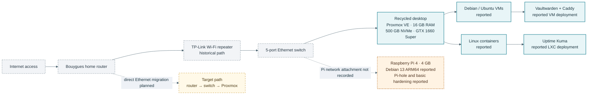

# GRIMM HOMELAB

> Self-Hosted Infrastructure, Networking & Cybersecurity Laboratory

[French version](README.fr.md) · [Documentation index](docs/README.md) · [Roadmap](ROADMAP.md)

GRIMM HOMELAB is a personal engineering portfolio about building, securing, observing, and documenting a resource-constrained home lab. It records practical work across Linux, Proxmox VE, networking, self-hosted services, security monitoring, and automation.

> **Evidence note:** Hardware and service details below come from owner-provided historical notes. They were not checked against live devices for this repository update. Each project page distinguishes reported work, verified research, and future experiments. No passwords, private keys, addresses, or real OSINT results belong in this portfolio.

## At a glance

- **Virtualization host:** recycled desktop, Proxmox VE, 16 GB DDR4, 500 GB NVMe, NVIDIA GTX 1660 Super.
- **Edge node:** Raspberry Pi 4 Model B, 4 GB RAM, reported Debian 13 ARM64 and Pi-hole service.
- **Previously reported services:** Vaultwarden behind Caddy with local HTTPS; Uptime Kuma in an LXC.
- **Completed learning lab:** Wazuh SIEM fundamentals and initial Ubuntu Server deployment experiments. No permanent Wazuh deployment is claimed.
- **Research only:** Eye of God repository review and RuView hardware/architecture review. Neither tool was run.

## Technology areas

| Area | Technologies and topics |
| --- | --- |
| Virtualization | Proxmox VE, KVM virtual machines, LXC containers |
| Operating systems | Debian, Ubuntu Server, Linux administration, ARM64 |
| Networking | Home routing, Ethernet, DNS, Wi-Fi troubleshooting, packet loss analysis |
| Security | SSH keys, UFW, Fail2ban, HTTPS, access control, privacy review |
| Monitoring | Uptime Kuma; Prometheus, Grafana, and Alertmanager planned |
| Automation | Ansible, Docker Compose, Infrastructure as Code planned |
| Self-hosting | Vaultwarden, Caddy, Pi-hole |
| Security operations | Wazuh architecture, log collection, alert triage, FIM and vulnerability detection concepts |

## Infrastructure overview

The current documentation reflects the historical network path reported by the owner: Internet router → Wi-Fi repeater → Ethernet switch → Proxmox desktop. A direct Ethernet connection is a planned reliability improvement. The Raspberry Pi's precise physical attachment and current service reachability have not been recorded.

See the [architecture overview](docs/architecture/overview.md), [network topology](docs/networking/topology.md), and [Proxmox inventory](docs/infrastructure/proxmox.md). Mermaid sources are kept in the Markdown pages that render them.

## Project showcase

| Project | Status | Documentation |
| --- | --- | --- |
| Proxmox VE | Previously configured, owner-reported | [Infrastructure and virtualization](docs/infrastructure/proxmox.md) |
| Raspberry Pi and Pi-hole | Previously configured, owner-reported | [Raspberry Pi services](docs/services/raspberry-pi-pihole.md) |
| Vaultwarden and Caddy | Previous deployment reported; current state unverified | [HTTPS flow and review notes](docs/services/vaultwarden-caddy.md) |
| Uptime Kuma | Initial monitoring setup reported | [Monitoring record](docs/services/uptime-kuma.md) |
| Linux hardening | SSH keys, UFW, and Fail2ban reported for the Pi | [Security notes](docs/security/hardening.md) |
| Wazuh SIEM | Completed learning lab; not a permanent service | [Architecture, experiments, and lessons](docs/wazuh-lab/README.md) |
| OSINT research | Research only; no tools run | [Eye of God and RuView review](docs/osint-lab/README.md) |
| Observability and automation | Planned | [Observability](docs/future/observability.md) · [Automation](docs/future/automation.md) |

## Security and troubleshooting

The portfolio separates owner-reported controls from verified configurations. Current notes describe SSH key authentication, UFW, and Fail2ban on the Raspberry Pi, plus local HTTPS for Vaultwarden. Firewall rules, update state, backup recovery, TLS settings, service exposure, and alert delivery still need dated evidence before they can be called current.

Previous network investigations included packet loss toward the gateway and the Internet. The repeater is a hypothesis to test, not a proven root cause. The [troubleshooting record](docs/troubleshooting/network-instability.md) preserves that distinction and lists measurements for a future Ethernet comparison.

## Wazuh learning lab

The Wazuh page explains the agent → manager → indexer → dashboard data path, SIEM concepts, file integrity monitoring, vulnerability detection, and basic alert triage. The owner reports an initial Ubuntu Server deployment experiment and RAM/swap pressure. The exact Wazuh version, components exercised, measurements, and test output were not supplied, so no executed feature is claimed.

## OSINT research lab

“Eye of God” is an ambiguous name. The reviewed `RykerWilder/eye-of-god` GitHub project is a self-hosted OSINT dashboard with features described by its owner; it is not verified as the same service as the Russian Telegram bot sometimes translated as “Eye of God.” Its features were inspected in the repository but not executed. Any future exercise must use synthetic data, the owner's accounts, or a documented authorized scope. RuView is documented as privacy-sensitive Wi-Fi sensing research, not as a deployed service.

## Lessons and roadmap

The central engineering lessons are to measure before assigning causes, plan resource limits before running a SIEM stack, keep service exposure explicit, and document reproducible evidence without disclosing private data. The [roadmap](ROADMAP.md) tracks completed learning, previous configurations, research, and planned work separately.

## About the maintainer

The maintainer holds a BUT in Computer Science, specializing in systems administration, deployment, and security, and is pursuing advanced training in secure infrastructure administration and cybersecurity. This portfolio documents personal learning and engineering practice. No public contact links were supplied for inclusion.

## Documentation and quality

Start at the [documentation index](docs/README.md). Reusable Codex guidance is in [AGENTS.md](AGENTS.md), [homelab documentation](.agents/skills/homelab-documentation/SKILL.md), [architecture diagrams](.agents/skills/architecture-diagrams/SKILL.md), [cybersecurity review](.agents/skills/cybersecurity-review/SKILL.md), and [portfolio quality](.agents/skills/github-portfolio-quality/SKILL.md). Local documentation checks use the exact tool versions in `package-lock.json`; GitHub Actions are restricted to read-only repository access. See the [quality-control decision](docs/decisions/quality-controls.md).

## Licensing

No repository-wide license has been selected. The referenced projects keep their own licenses; the Eye of God candidate and RuView repositories currently declare MIT. Please confirm a license before inviting code reuse or external contributions.
