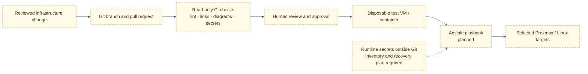

# Target automation workflow

## Status

Ansible, Docker Compose, Infrastructure as Code, and GitHub Actions are listed as future areas of study. The repository currently has documentation-quality automation only; it does not deploy to Proxmox or manage homelab hosts.

- [GitHub workflow](../../.github/workflows/quality.yml)
- [Project rules](../../AGENTS.md)

## Staged learning path

1. Write an Ansible playbook that manages one disposable Debian VM with a documented rollback path.
2. Keep inventories, SSH keys, vault passwords, and API tokens outside Git; use a secret manager or encrypted variable mechanism for any later shared workflow.
3. Add idempotence checks, syntax checks, and a second run that demonstrates no unintended changes.
4. Use pull requests and read-only CI before any deployment action.
5. Require human approval and a specific target inventory before allowing automation to touch the homelab.
6. Test restore and failure handling before adding more hosts or services.

## Security boundaries

The current GitHub Actions workflow has `contents: read` permission and performs no deployment. Do not add Proxmox credentials, SSH material, broad `secrets: write`, or automatic infrastructure changes to CI without a separately reviewed design.
