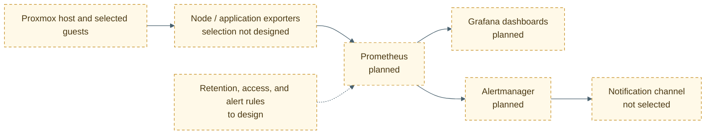

# Target observability architecture

## Status

Prometheus, Grafana, and Alertmanager are planned projects. No exporters, dashboards, retention policy, or notification route are configured or tested in the supplied evidence.

- [Uptime Kuma previous setup](../services/uptime-kuma.md)
- [Proxmox resource constraints](../infrastructure/proxmox.md)

## Proposed scope

Start with a small set of host and guest health signals: CPU, memory, swap, disk capacity, filesystem usage, and service reachability. Avoid collecting personal activity or high-cardinality labels. Keep Prometheus scrape access and Grafana administration on a trusted network.

## Design questions

- Which host and guest metrics are useful enough to retain?
- What retention limit fits the NVMe and backup budget?
- Which metrics distinguish hypervisor pressure from one guest's pressure?
- Which alerts have a clear action and a known owner?
- Which notification channel can be tested without exposing credentials?
- How will configuration and dashboards be backed up and restored?

## Validation plan

In a disposable VM, verify one exporter scrape, one Grafana panel, one intentional test alert, and alert recovery. Record versions, resource use, retention, and access controls. Do not label this target operational until those checks pass on the actual lab.
