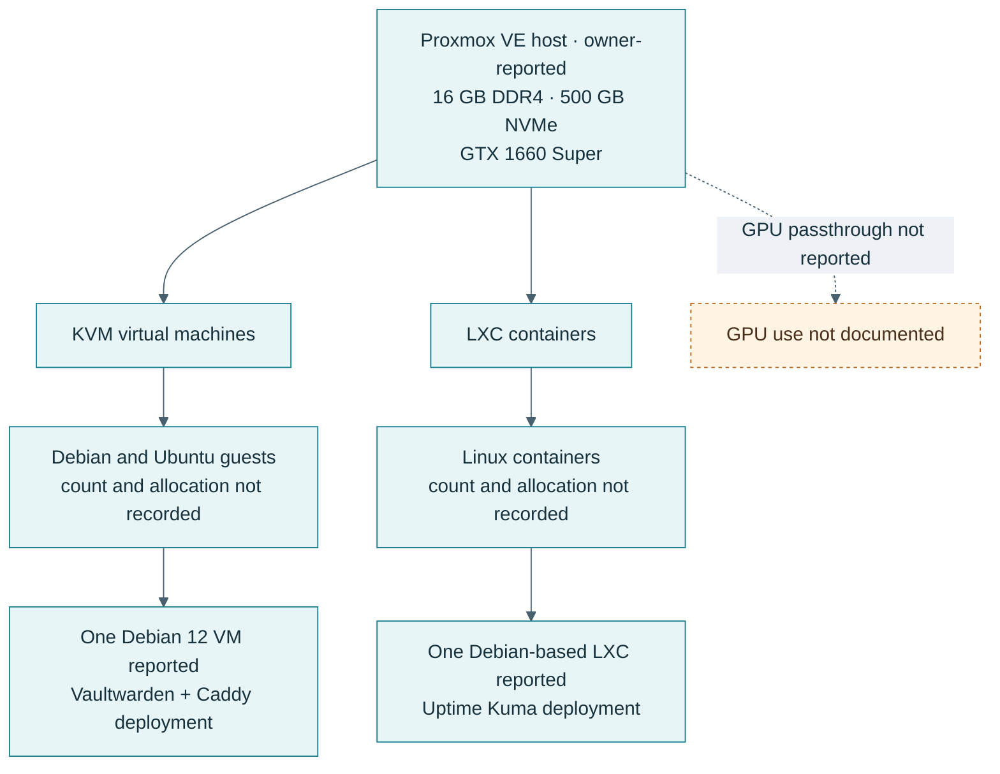
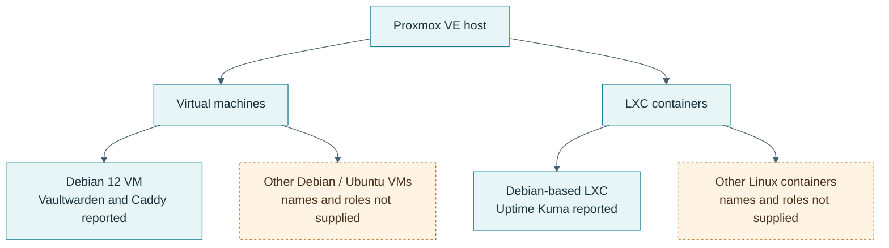

# Proxmox VE and virtualization host

## Overview

The owner reports a Proxmox VE installation on a recycled desktop with 16 GB DDR4 RAM, a 500 GB NVMe SSD, and an NVIDIA GTX 1660 Super. Multiple Debian and Ubuntu virtual machines and Linux containers have been used. The host was not reachable from this documentation task, so version, present operating state, guest count, resource allocation, storage health, and GPU use are unverified.

## Objectives and architecture

The host provides a constrained virtualization platform for Linux administration, service deployment, troubleshooting, and security experiments. The diagrams distinguish the two named guest deployments from guests whose roles were not supplied.

### Virtualization overview



### VM and LXC organization



## Requirements and constraints

- 16 GB host memory is shared across the hypervisor, VMs, containers, and file cache; per-guest allocations were not supplied.
- 500 GB NVMe capacity is shared by host and guest storage; free space and backup capacity are unknown.
- The GPU is part of the owner-reported hardware inventory. No GPU passthrough or workload is claimed.
- Wazuh experiments reportedly encountered RAM and swap pressure; see the [Wazuh learning lab](../wazuh-lab/README.md).

## Installation and configuration status

Installation and administration work are owner-reported. No install procedure, cluster configuration, storage layout, bridge/VLAN configuration, firewall policy, backup schedule, or recovery test was available to reproduce. This page deliberately does not invent those settings.

## Safe evidence to collect

On the host, record and review the output locally before redaction:

```bash
pveversion -v
free -h
lsblk -o NAME,SIZE,TYPE,MODEL
pvesm status
qm list
pct list
```

These commands were not run for this portfolio. Review storage labels, guest names, identifiers, and any network information before publishing excerpts. Record VM/LXC memory, CPU, disk size, and purpose only when confirmed.

## Security and recovery checklist

- Keep the management interface on a trusted management network and restrict access to named administrators.
- Record update status, two-factor authentication status if enabled, and the actual firewall policy without publishing credentials.
- Confirm guest isolation, backup destination, retention, and an actual restore test before claiming recoverability.
- Keep configuration exports and API tokens out of Git.
- Record the local network path in the [topology page](../networking/topology.md) only after checking it on site.

## Validation and lessons

No current host health or restore check was possible. The next useful record is a redacted inventory plus one verified restore exercise to an isolated target. This turns the existing hardware work into measurable evidence without exposing the management plane.

## References

- [Proxmox VE documentation source repository](https://github.com/proxmox/pve-docs)
- [Proxmox VE project](https://github.com/proxmox/pve-manager)
