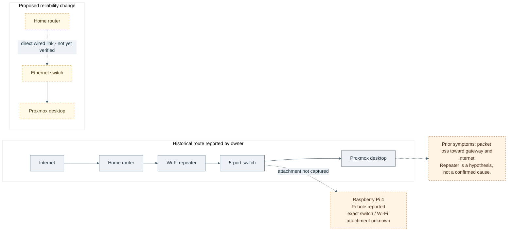

# Network topology and reliability work

## Overview

The topology below reflects the historical route supplied by the owner: home router → Wi-Fi repeater → five-port switch → Proxmox desktop. A move to direct Ethernet was proposed to improve reliability. The Raspberry Pi runs Pi-hole according to owner notes, but its physical attachment to the network was not recorded.

- [Pi-hole DNS flow](../services/raspberry-pi-pihole.md#dns-flow)
- [Network instability record](../troubleshooting/network-instability.md)

## Reported symptoms

- Intermittent packet loss toward the local gateway.
- Intermittent Internet reachability.
- Connectivity instability observed while using a Wi-Fi repeater path.
- Ping checks and investigation of possible Proxmox impact.
- No dated output, packet capture, or confirmed root cause was supplied.

The repeater is a testable hypothesis. The available notes do not establish it as the cause, and they do not establish that Proxmox caused the losses.

## Proposed comparison

1. Record the test date, router/switch/host link state, and whether the repeater is in the path.
2. From one wired client, send a modest, fixed set of ICMP probes to the local gateway and a public test address; record loss and latency without retaining personal addresses in public logs.
3. Repeat under comparable load after a direct Ethernet migration.
4. If local loss remains, inspect link negotiation, cable, switch port counters, and host NIC logs. If only external loss remains, inspect the router/WAN path.
5. Correlate any change with Proxmox guest load and interface counters before assigning a cause.

These are proposed diagnostic steps, not commands or results from the historical investigation.

## Security and privacy

Do not publish real gateway addresses, public IPs, Wi-Fi network names, MAC addresses, device names, or raw packet captures. Redact those details before adding evidence to the repository.
