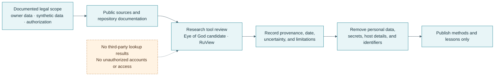

# OSINT research lab

## Scope and safeguards

This page records repository research and learning goals. Neither Eye of God candidate nor RuView was installed or executed. Future hands-on work is limited to the owner's accounts, synthetic data, or another explicitly authorized scope. Do not publish third-party lookup results, personal identifiers, private profile links, raw metadata, or Wi-Fi sensing results tied to identifiable people.

- [Screenshot and redaction checklist](../media/capture-checklist.md)

## Eye of God: project identity and name ambiguity

GitHub search returns multiple unrelated repositories using “Eye of God” or the translated phrase “Glaz Boga.” The repository reviewed for this portfolio is [`RykerWilder/eye-of-god`](https://github.com/RykerWilder/eye-of-god), whose README describes a self-hosted OSINT dashboard. Its GitHub owner account is `RykerWilder`; no separate identity or affiliation was verified. This repository is not established as the canonical source for the Russian Telegram bot sometimes translated as “Eye of God.” The name ambiguity should be resolved with the owner before any installation experiment.

**Research snapshot:** repository `main` at commit `50aa3815e51d4ab074e0aeb3f43378af773e2838`, reviewed 2026-10-20. Findings below describe the code and documentation at that revision; they are not runtime test results.

### License and architecture

The reviewed repository includes an MIT license. Its README describes a React/Vite frontend and a Python FastAPI backend connected with Docker Compose. The inspected frontend has a `package-lock.json`; `package.json` uses version ranges for some direct dependencies. The backend requirements file pins listed Python packages, but the backend Dockerfile fetches `theHarvester` from its mutable `master` branch. The README lists Docker Compose or Python 3.13 and Node.js 20 for manual operation, plus optional API keys for some data sources.

### Advertised features

The README and source tree describe integrations for username searches (Sherlock and Maigret), email service checks (Holehe), WHOIS and DNS queries, theHarvester, file metadata extraction, AbuseIPDB, IP geolocation, Google query construction, a CVE feed, and proxy checks. These features were not run or independently tested here.

The README also identifies UI categories such as Scanner, Malware, Crypto, and Terminal as placeholders that are not implemented in the backend. Some data sources require API keys or are subject to external service limits. Results can be incomplete, stale, inaccurate, or prohibited by a source's terms; they need independent validation.

### Privacy and deployment risks

- Inputs may contain usernames, email addresses, IP addresses, domains, uploaded files, or metadata with author names and GPS/EXIF location.
- The repository describes contact discovery and location-related lookups. Such features can facilitate unwanted profiling or doxxing; use only self-owned, synthetic, or explicitly authorized records.
- The inspected Compose file publishes frontend and backend ports without an explicit loopback or LAN bind address. Review network exposure before any local trial.
- The README requires an `.env` file and describes API keys. Never commit it or place real keys in screenshots, logs, sample commands, or this portfolio.
- The backend Dockerfile installs system packages and fetches one tool from mutable `master`; the container base images use tags rather than digests. Review and pin the software supply chain before any use.
- Do not upload personal documents to the metadata feature. A metadata extractor may reveal author, timestamp, or GPS fields even when visible content appears harmless.

### Safe next step

First confirm the intended project with the owner. If the self-hosted dashboard is intended, review its source, licenses, Compose bindings, API key handling, network calls, and data retention in a disposable environment using synthetic inputs only. No commands, containers, or lookups were run for this page.

## RuView: Wi-Fi CSI sensing research

The reviewed repository is [`ruvnet/RuView`](https://github.com/ruvnet/RuView), reviewed at commit `a1ca023ee872683d160250d47ae3d4d228af55a0` on 2026-10-20. Its README describes a Wi-Fi Channel State Information (CSI) platform for presence, motion, and experimental vital-sign estimates. The firmware documentation identifies ESP32-S3 as the production target and ESP32-C6 as a research target. The user guide also describes a simulated mode and alternate CSI sources.

The upstream documentation's hardware table lists an ESP32-S3 mesh of several boards or supported CSI-capable network hardware for live input; it lists RSSI-only laptop input as a less capable option. Its general prerequisites list 4 GB RAM minimum and 8 GB or more recommended. These are upstream project statements, not results from this home lab. The owner-provided hardware inventory mentions a 4 GB Raspberry Pi and a 16 GB desktop, but no ESP32 CSI board or supported CSI network adapter. Live sensing feasibility is therefore unconfirmed.

The upstream repository declares an MIT license. Its firmware guide cites ESP-IDF 5.4; its user guide documents Docker and Rust source-build paths. No binary was downloaded, no container was run, and no sensing accuracy is claimed.

### Privacy and research boundaries

Wi-Fi sensing may infer occupancy, movement, or physiological signals without a camera. Lack of imagery does not remove the privacy impact. Any future experiment must be confined to a controlled room, use informed consenting participants or synthetic data, avoid recording bystanders, minimize retention, and avoid health or safety decisions based on experimental estimates. No deployment or operational capability is claimed.

### Feasibility assessment

- Existing notes do not list an ESP32 CSI sensor or supported CSI network adapter.
- The Raspberry Pi's reported 4 GB RAM is below the upstream guide's 8 GB recommended host memory, and its performance is not established.
- The desktop has a reported 16 GB RAM, but CPU compatibility, sensor interfaces, Docker behavior, and compute performance were not tested.
- Simulated mode could be reviewed as a software-only learning path, but it would not validate live sensing or accuracy.

## References

- [RuView repository](https://github.com/ruvnet/RuView)
- [RuView user guide](https://github.com/ruvnet/RuView/blob/main/docs/user-guide.md)
- [RuView ESP32 CSI node guide](https://github.com/ruvnet/RuView/blob/main/firmware/esp32-csi-node/README.md)
- [Agent Skills format specification](https://github.com/agentskills/agentskills/blob/main/docs/specification.mdx)
