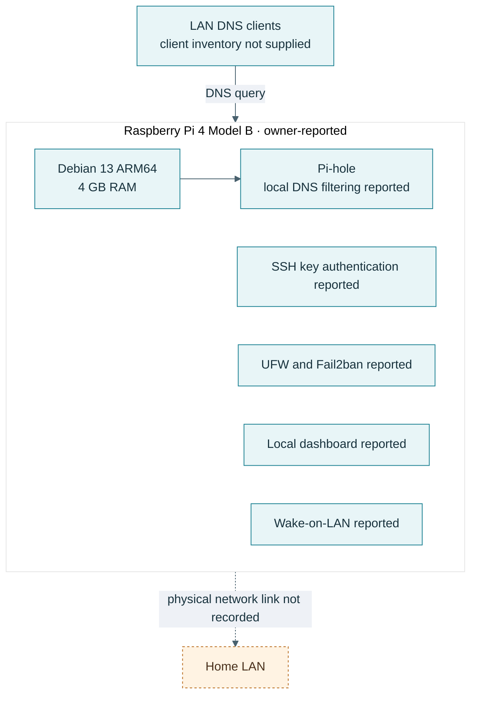
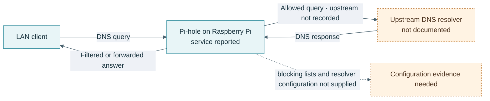

# Raspberry Pi and Pi-hole

## Overview

Owner-provided notes describe a Raspberry Pi 4 Model B with 4 GB RAM, Debian 13 ARM64, and Pi-hole as a local DNS filtering service. They also report SSH key authentication, UFW, Fail2ban, Wake-on-LAN, and a local dashboard. Current versions, service reachability, DNS upstream, firewall rules, and the Pi's exact network attachment have not been checked.

### Raspberry Pi service map

## DNS flow

- [Network topology](../networking/topology.md)
- [Hardening record](../security/hardening.md)

## Objectives

- Provide a local DNS filtering service for authorized home clients.
- Practice administration of a small ARM64 Linux node.
- Document the DNS path, service health, security controls, and restore process without exposing local identifiers.

## Configuration and evidence status

The owner reports a Pi-hole installation and previous service tests. No Pi-hole version, upstream resolver, blocklist configuration, DHCP role, query sample, uptime result, or backup was supplied. The diagram marks those details as unknown rather than filling them in.

## Proposed validation

When the device is available, record its service version and test one synthetic domain query from a LAN client. A future runbook may use a placeholder form such as `dig example.org @<PIHOLE_LAN_ADDRESS>`; replace the placeholder locally and redact the address and client identity from public evidence. Confirm both an allowed response and a deliberately blocked test domain from a maintained test list before describing filtering as verified.

No such command was run for this portfolio.

## Security and recovery

- Restrict the DNS and administration interfaces to the intended LAN segments.
- Confirm whether the Pi provides DHCP before changing DNS settings elsewhere.
- Keep SSH keys, dashboard credentials, query logs, and client inventories private.
- Back up Pi-hole configuration through its supported method and test restore to a separate instance before claiming recovery.
- Review update cadence, local firewall rules, and Fail2ban status as described in [Linux hardening](../security/hardening.md).

## Problems and lessons

No Pi-hole incident or measured DNS availability was supplied. The key documentation improvement is to retain a redacted before/after DNS test and identify the upstream resolver and DHCP owner in private notes, then publish only non-sensitive configuration facts.

## Screenshots

No screenshot was supplied. Follow the [capture checklist](../media/capture-checklist.md) before adding any dashboard image.

## References

- [Pi-hole documentation repository](https://github.com/pi-hole/docs)
- [Pi-hole project](https://github.com/pi-hole/pi-hole)
