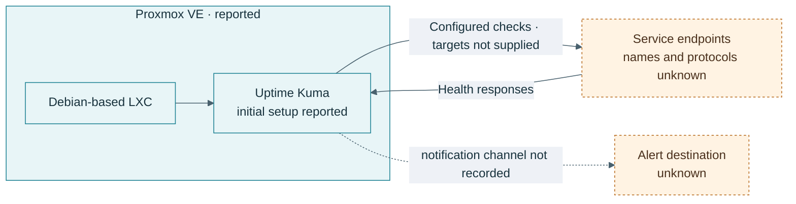

# Uptime Kuma

## Overview

The owner reports an initial Uptime Kuma setup in a Debian-based LXC on Proxmox. The version, monitor list, notification channel, and current health are unknown. No monitor result or dashboard screenshot was provided.

## Objectives

Describe the monitoring service and show which evidence is still needed before availability claims can be made.

## Setup record

- **Runtime:** Debian-based LXC, owner-reported.
- **Application:** Uptime Kuma, initial setup reported.
- **Targets:** not supplied.
- **Notifications:** not supplied.
- **Validation:** no dated result supplied.

## Security and operations

- Use read-only checks that do not trigger state changes on monitored services.
- Store notification credentials outside the repository and redact monitor URLs that contain tokens.
- Restrict access to the Uptime Kuma administration interface.
- Back up its database and test restoration before describing the service as recoverable.
- Prefer independent checks for the hypervisor, DNS, and Internet path so one failure does not hide another.

## Proposed next validation

Record one non-sensitive HTTP or TCP monitor, its interval, expected status, and a controlled failure/recovery observation. The target and alert destination should remain private unless the owner explicitly approves publishing a sanitized example. No uptime or alert behavior is claimed here.

## Reference

- [Uptime Kuma project](https://github.com/louislam/uptime-kuma)
