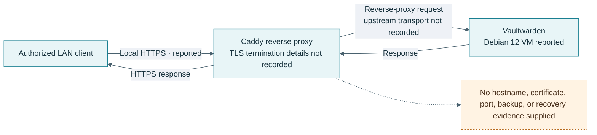

# Vaultwarden and Caddy

## Overview

The owner reports a Debian 12 VM with Vaultwarden behind a Caddy reverse proxy and local HTTPS. Past access tests are reported, but the domain, certificate model, versions, upstream transport, authentication settings, backup path, and restore evidence were not provided. No service was contacted during this documentation work.

- [Proxmox guest inventory](../infrastructure/proxmox.md)
- [Capture checklist](../media/capture-checklist.md)

## Objectives

Document the reverse-proxy boundary, local TLS behavior, data protection, and recovery process for a self-hosted password manager. The diagram intentionally leaves the upstream transport and certificate details unspecified.

## Reported setup

| Area | Available note | Not recorded |
| --- | --- | --- |
| Guest | Debian 12 VM | VM allocation and current OS updates |
| Application | Vaultwarden deployed | Version, admin settings, signup policy, attachments, data path |
| Proxy | Caddy reverse proxy | Caddyfile, upstream protocol, headers, exposed interfaces |
| TLS | Local HTTPS reported | Certificate issuer, trust distribution, expiry and renewal test |
| Validation | Access tests reported | Test date, client, result, and recovery test |

## Security review before claiming a current deployment

- Confirm the proxy is reachable only on the intended local interfaces and no router port-forward exposes it unintentionally.
- Confirm registration and administrative controls, strong unique credentials, MFA availability, update status, and rate limiting.
- Treat the vault database and attachments as highly sensitive. Keep them encrypted and outside public Git history.
- Verify Caddy's certificate chain and renewal behavior using the actual local hostname, without publishing that hostname or certificate material.
- Back up the data and configuration, then test restore to an isolated VM.
- Avoid public screenshots containing vault names, usernames, browser tabs, URLs, or saved account metadata.

## Validation and troubleshooting

The earlier access tests are owner-reported but not reproducible from the supplied notes. A new record should capture the date, client type, expected local URL pattern with the host redacted, HTTP/TLS result, and whether the service remains inaccessible from outside the intended network.

## References

- [Vaultwarden project](https://github.com/dani-garcia/vaultwarden)
- [Caddy project](https://github.com/caddyserver/caddy)
