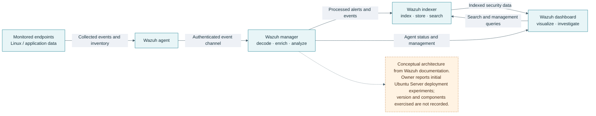

# Wazuh SIEM | Architecture, Deployment Experiments & Lessons Learned

## Status

**Completed Learning Lab** — the owner reports completing the initial Wazuh learning and discovery phase, including deployment experiments on Ubuntu Server. This status does not mean a permanent or production Wazuh deployment exists. No version, configuration, event sample, test report, or current service state was provided.

## Introduction to SIEM

A Security Information and Event Management system collects security-relevant events from multiple sources, normalizes and correlates them, and presents alerts and investigation context. A SIEM supports analyst workflows; it does not make an alert correct by itself or replace endpoint, network, and identity controls.

## Wazuh architecture

Wazuh documents one endpoint component and three central components: the agent, manager, indexer, and dashboard. The diagram is an architectural explanation, not a reconstruction of the owner's exact deployment.

- [Official Wazuh architecture documentation source](https://github.com/wazuh/wazuh-documentation/blob/main/source/getting-started/architecture.rst)

### Components

| Component | Role in the documented architecture |
| --- | --- |
| Wazuh agent | Collects configured endpoint and application data and sends it to the manager. Modules can include log collection, inventory, security configuration assessment, and file integrity monitoring. |
| Wazuh manager | Receives agent data, decodes and analyzes events, applies detection content, and forwards processed data. |
| Wazuh indexer | Indexes and stores events and related security data for search and analytics. |
| Wazuh dashboard | Queries the indexer for visualization and investigation and exposes management views for authorized operators. |

Exact communication protocols and ports vary by Wazuh release. They are omitted here because the owner's experimental version was not recorded.

## Concepts studied

### Log collection and event analysis

Agents can collect operating-system and application logs. The manager interprets event fields and applies configured detection rules; analysts then examine alert context, related events, and endpoint state. Collection coverage depends on the configured sources and does not imply that every security event is visible.

### File integrity monitoring

File integrity monitoring (FIM) records selected file or directory state and reports changes such as creation, deletion, or modification. Useful lab evidence includes the watched paths, excluded paths, baseline timing, a controlled test-file change, the resulting event, and cleanup. No FIM test result is claimed for this lab.

### Vulnerability detection

Vulnerability detection compares software inventory with vulnerability intelligence and affected-version data. Results depend on inventory freshness, operating-system support, feed updates, and version matching. A finding is a prioritization signal that requires validation, not proof that the system is exploitable.

### Basic incident workflow

1. Confirm the alert's timestamp, rule context, endpoint identity, and collection health.
2. Review related events and inventory over a narrow time window.
3. Compare the observation with an authorized baseline or controlled lab action.
4. Record evidence, confidence, and alternative explanations.
5. Take only an approved response action; verify the change and document recovery.

This is a proposed learning workflow, not a report of a specific incident.

## Ubuntu Server deployment experiments

The owner reports trying Wazuh under Ubuntu Server and studying the component architecture. The available notes do not say whether the Manager, Indexer, Dashboard, or Agent were all running together, nor which version or installation path was used. This portfolio therefore describes the architecture and learning outcomes without claiming any specific feature was successfully exercised.

## Virtualization constraints and RAM/swap troubleshooting

The reported Proxmox host has 16 GB of RAM shared by the hypervisor and several VMs/containers. The owner encountered memory and swap saturation during Wazuh experimentation. No allocation table, measurements, kernel logs, or timestamps were supplied, so there is not enough evidence to assign the pressure to a specific Wazuh component.

| Check to record in a future experiment | Why it helps |
| --- | --- |
| VM memory limit and ballooning configuration | Establishes the guest's actual memory budget. |
| `free -h` and `swapon --show` before and during startup | Captures available RAM and swap use. |
| `vmstat 1` during a short, controlled run | Shows sustained memory pressure and paging activity. |
| `journalctl -k` and service logs for the same time window | Finds OOM kills, service restarts, or indexing errors. |
| Guest workload, agent count, and data retention | Separates component overhead from event volume and storage behavior. |

Do not copy raw logs or host identifiers into public documentation. No command in this table was run for this portfolio.

## Lessons learned

- Plan the memory budget for all central components before installing a SIEM stack on a small host.
- Start with a bounded all-in-one lab and a small, known event source; record the version and each component's health.
- Keep event retention and test data controlled so indexing growth does not surprise a resource-constrained guest.
- Treat swap activity and service health as measurements to correlate, not as proof of a single root cause.
- Save a clean baseline and a teardown/recovery procedure before expanding the experiment.

## Next-stage experiments

1. Record the Ubuntu and Wazuh versions and VM CPU, RAM, disk, and swap settings.
2. Deploy in an isolated lab with one test endpoint and synthetic log events.
3. Verify one agent check-in and one expected alert, preserving sanitized output and timestamps.
4. Test a harmless FIM change on a disposable file and document the alert path.
5. Review vulnerability inventory behavior with a known test package and record feed freshness.
6. Capture memory metrics before, during, and after startup; stop before it affects unrelated guests.

## References

- [Wazuh documentation source](https://github.com/wazuh/wazuh-documentation)
- [Wazuh architecture source](https://github.com/wazuh/wazuh-documentation/blob/main/source/getting-started/architecture.rst)
- [Wazuh project](https://github.com/wazuh/wazuh)
